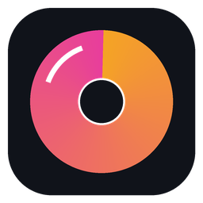

# PF3 Studio



**[Download the latest release](https://github.com/RamenNuudlss/PF3-Studio/releases/latest)** - unzip and run `PF3 Studio.exe` (portable, no install, no driver).

Driverless replacement software for the **Microboards PF-3 Print Factory** disc printer on Windows 10/11.
It replaces the Microboards printer driver, the Microboards Toolbox, the Print Queue Utility and SureThing.

## How it works
The PF-3 is an HP Specialty Printing Systems "SI500" engine (USB `03F0:6104`, DeskJet 5650 class).
PF3 Studio talks to it through Windows' built-in USB printing driver (`usbprint.sys`), the same interface
the original Toolbox used, so **no driver needs to be installed**:

* **Printing**: designs are rendered at 600 dpi (1200 dpi for Max DPI) and sent as PCL3GUI raster with
  HP Mode 10 compression. The job layout matches the original "PF3 Test Print" job byte for byte, and the
  compressor is byte-identical to HP's on the original test disc. It decodes each row the way the printer
  does, so blue rounding can't build up from row to row.
* **Status / ink**: read from the printer's IEEE-1284 device ID (`S:` field) via `IOCTL_PAR_QUERY_DEVICE_ID`.
* **Maintenance**: the same firmware commands the Toolbox sends (`fm.flow 235` clean levels 1-3,
  `fm.flow 220` margin calibration, `fm.flow 238` pen calibration, `fm.flow 236` belt exercise).

## Feature parity with the original software
| Original | PF3 Studio |
|---|---|
| Driver: Color / grayscale, saturation, brightness, colour tone, per-ink volume | Print > Color (live preview) |
| Driver: Max DPI, ink volume, dry time | Print > Quality, Ink & dry time |
| Driver: outer/inner diameter, mask types | Print > Printable area (+ business-card and 80 mm masks) |
| Driver: alignment offsets | Print > Alignment (+ diagnostic disc to measure them) |
| Driver: Text & Graphics / Photo, Normal / Best / Max DPI | Print > Quality |
| Driver: ink levels, 10/5/3 % warnings | Printer page, tray, warnings before each disc (configurable) |
| Toolbox: Light / Regular / Heavy clean + verification disc | Printer > Cleaning |
| Toolbox: Pen calibration (4 patterns) | Printer > Pen calibration wizard |
| Toolbox: Automatic margin calibration, Exercise belt, Test print | Printer page |
| Print Queue Utility | Queue > Clear all |
| SureThing label designer | Design page (layers, curved text, gradients, templates, undo/redo) |

**New:** batch / variable-data printing (CSV, `{{fields}}`, numbering), a local API and CLI for Boxset,
ink-history and cost-per-disc statistics, maintenance log, belt-exercise reminder, a diagnostic disc,
a tray app with notifications, and resuming after the hopper runs empty.

## Boxset / automation
```
POST http://127.0.0.1:47823/print
{ "templatePath": "D:\\labels\\movie.pf3label", "fields": {"title": "..."}, "copies": 1, "quality": "best" }
{ "image": "C:\\art\\disc.png" }            # path, base64 or data URL; cover-fits the disc
GET  /status          POST /cancel/<jobId>
"PF3 Studio.exe" --print art.png --copies 2 --quality maxdpi
"PF3 Studio.exe" --template movie.pf3label --fields "{\"title\":\"Heat\"}"
```

## Original software files
The test disc, cleaning-verification disc and pen-alignment patterns are HP/Microboards jobs and are not
in this repo. Get `Toolbox.exe` from Microboards' `PF-3_Installer.exe`, then run
`python tools/extract_vendor.py Toolbox.exe` (or import the .pcl files in Settings).

## Build
```
npm install
npm run build        # main + UI
npm run dist         # Windows x64 zip/installer in release/
PF3_PRINT_TO_DIR=out npm start   # virtual printer: writes jobs to ./out instead of USB
```


## Disclaimer
Not affiliated with Microboards Technology or HP. PF-3, Print Factory and SureThing are trademarks of their owners.
The `tools/*.py` scripts are the analysis/verification helpers used while building this (PCL dumper, Mode 10 decoder).
